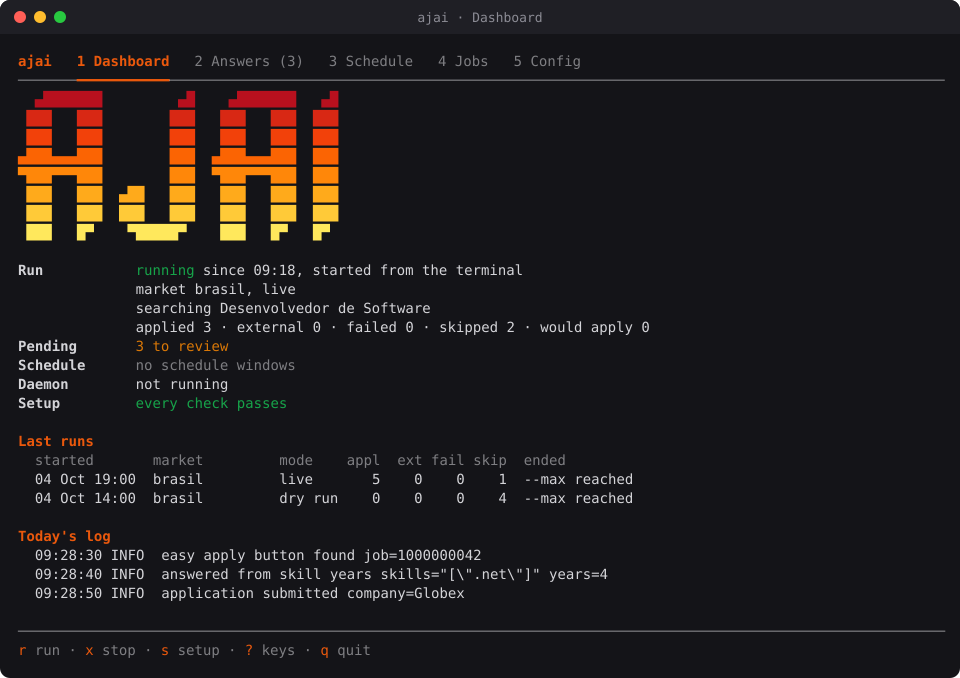
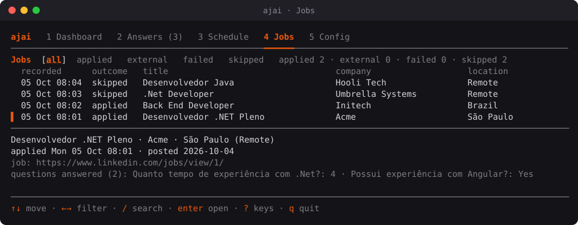
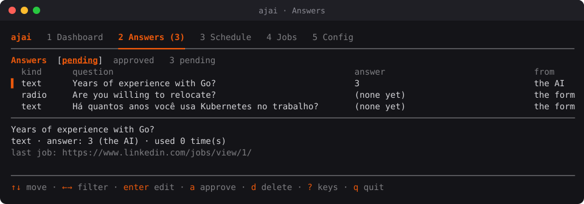

<p align="center">
  
</p>

<p align="center">
  <b>LinkedIn Easy Apply from your own Chrome, at a human pace.</b><br>
  One binary. Your machine, your browser, your account.
</p>

<p align="center">
  <a href="https://github.com/luizfreitas27/ajai/releases/tag/v0.1.0"></a>
  <a href="https://github.com/luizfreitas27/ajai/actions/workflows/ci.yml"></a>
  
  
  
</p>

<p align="center">
  <a href="#install">Install</a> ·
  <a href="#first-run">First run</a> ·
  <a href="#the-tui">The TUI</a> ·
  <a href="#answers-the-ai-and-the-help-pause">Answers &amp; AI</a> ·
  <a href="#everyday-commands">Commands</a> ·
  <a href="#schedule-windows">Schedule</a> ·
  <a href="#troubleshooting">Troubleshooting</a>
</p>

<p align="center">
  
</p>

`ajai` searches LinkedIn for jobs that match your criteria and submits Easy Apply
applications from your own machine, in a real, visible Chrome, with your own account. It
fills each form from your configuration, remembers every answer it gives so you can review
them, knows the difference between applying in Brazil and abroad, and tells you on Telegram
how a run went.

## What it does

- **Searches and screens.** Search terms, location and LinkedIn's filters, then a screen of
  each job: a blacklist of companies and words, required experience, security clearance and
  sponsorship. Reposts of a job it already handled are passed over.
- **Fills Easy Apply forms the way you would.** Name, phone, city, work authorization, visa,
  salary (monthly, annual or hourly), notice period and years of experience come from your
  config, in English and Portuguese. Your years per technology answer "How long have you
  used X?". It uploads your resume, and it never guesses.
- **Remembers.** Every answer it gives, or that you type in a help pause, goes to an answer
  memory you review in the TUI, on the command line or from Telegram. The next form that
  asks the same goes through.
- **An AI for the rest, optional.** OpenAI, Gemini, DeepSeek or a local model answers what
  nothing else can. It never sees your phone, email or address, and it is never asked about
  visas, salary or other sensitive questions.
- **Paced like a person.** 15 applications an hour and 50 a run by default, with jittered
  pauses between jobs and form actions, typing a character at a time.
- **A full-screen TUI**, plus a daemon that runs on schedule windows, Telegram commands, a
  dry-run mode, and a job history you can export.

`ajai` is the Go successor of the Python
[Auto_job_applier_linkedIn fork](https://github.com/luizfreitas27/Auto_job_applier_linkedIn).
The behaviour was ported, not reinvented: same selectors, same question heuristics, same
answer memory. See `NOTICE`.

## Install

### What you need

| | |
|---|---|
| **System** | Linux, amd64 or arm64, with a desktop session (Wayland or X11). Chrome opens a visible window. |
| **Browser** | Google Chrome or Chromium. `ajai doctor` finds it. |
| **LinkedIn** | An account, with LinkedIn's display language set to **English** (Settings → Account preferences → Language). The selectors and heuristics expect it. |
| **Optional** | A Telegram bot for notices and remote commands, and an AI provider key. |

`ajai` never runs headless and never stores your LinkedIn password: you sign in once, by
hand, in a Chrome profile of its own.

### Download a release (recommended)

The repository is private, so the release files are downloaded with the
[GitHub CLI](https://cli.github.com/), signed in to an account with access to it
(`gh auth login`):

```bash
# 1. Download the archive for your machine (amd64 shown; use linux_arm64 on ARM) and the checksums
gh release download v0.1.0 --repo luizfreitas27/ajai \
  --pattern 'ajai_0.1.0_linux_amd64.tar.gz' --pattern 'checksums.txt'

# 2. Check it
grep linux_amd64 checksums.txt | sha256sum -c -     # must say: OK

# 3. Unpack and install it on your PATH
tar -xzf ajai_0.1.0_linux_amd64.tar.gz
install -m 0755 ajai ~/.local/bin/ajai

# 4. Confirm
ajai version                                        # ajai v0.1.0 (…) linux/amd64
```

If `ajai` is not found, add `~/.local/bin` to your `PATH` (for example
`export PATH="$HOME/.local/bin:$PATH"` in `~/.bashrc`). Every release is listed on the
[Releases](https://github.com/luizfreitas27/ajai/releases) page.

### Build from source

With Go 1.26 or newer and git access to the repository:

```bash
git clone git@github.com:luizfreitas27/ajai.git && cd ajai
go build ./cmd/ajai && ./ajai version
install -m 0755 ajai ~/.local/bin/ajai
```

Or in one line, with `GOPRIVATE` set because the repository is private:

```bash
GOPRIVATE=github.com/luizfreitas27 go install github.com/luizfreitas27/ajai/cmd/ajai@latest
```

A build from source reports a pseudo-version (`ajai version`). Releases carry the tag.

### Upgrade

Download and install the new release the same way: your configuration, answer memory,
history and Chrome profile stay where they are. If you installed the daemon's unit, run
`ajai daemon install` again so it points at the new binary.

### Uninstall

```bash
ajai daemon uninstall                 # only if you installed the daemon's unit
rm ~/.local/bin/ajai
```

That leaves your data. To remove it too (configuration and secrets, the history and answer
memory, logs, screenshots and the Chrome profile with its LinkedIn session):
`rm -r ~/.config/ajai ~/.local/share/ajai`.

## First run

The easiest way: type `ajai`. With nothing set up yet it opens on the **setup checklist**
(see [The TUI](#the-tui)), which walks you through the steps below, each one a key away.
By hand:

1. **Configure.** Either answer a short wizard:

   ```bash
   ajai init
   ```

   or bring everything over from the Python bot (settings, answer memory, job history,
   resume; never secrets):

   ```bash
   ajai import ~/Projects/Automations/Auto_job_applier_linkedIn
   ```

2. **Resume.** Put it in the resumes directory that `ajai doctor` prints (`resume.pdf` by
   default). Each market may have its own: `ajai config set markets.brasil.resume cv-pt.pdf`.

3. **Secrets**, only the ones you use, in the `.env` next to the config file (the TUI's
   Config tab writes them for you, in hidden fields):

   ```bash
   AJAI_AI_API_KEY=...              # an AI provider's key
   AJAI_TELEGRAM_BOT_TOKEN=123:ABC  # Telegram, both lines or neither
   AJAI_TELEGRAM_CHAT_ID=987654321
   ```

4. **Sign in to LinkedIn, once.** ajai uses a Chrome profile of its own, so your everyday
   Chrome stays open and free while it works:

   ```bash
   ajai login
   ```

   Chrome opens on LinkedIn; sign in by hand (ajai never types your password) and it closes
   once the feed appears. The session stays in the ajai profile.

5. **Your profile.** Set `questions.summary`, `questions.about` and `questions.skill_years`
   (see [Your profile](#your-profile) and [Skill years](#skill-years)). They answer the
   questions about your experience, and give the AI something to work from if you turn it
   on.

6. **Check.** `ajai doctor` tests Chrome, the profile (and whether LinkedIn is signed in
   there), the config, the secrets, the resume and the data directory, and prints every
   path in use.

7. **Dry run.**

   ```bash
   ajai run --dry-run --fast
   ```

   ajai searches, screens each job, fills every form and discards it at the Review step, so
   you can see the answers it would send. `--fast` shortens the pauses and only works with
   `--dry-run`.

8. **For real.** Start small, keep the Chrome window visible, then let the pacing limits do
   their job:

   ```bash
   ajai run --max 2
   ajai run
   ```

<details>
<summary><b>Coming from phase 1?</b></summary>

Phase 1 drove your everyday Chrome profile. A blank `settings.chrome_profile_dir` now means
the ajai profile, one of ajai's own: run `ajai login` once, or set
`settings.chrome_profile_dir` to your everyday profile (`ajai doctor` prints its path) to
keep the old behaviour. On the ajai profile a run closes its Chrome when it ends; on yours
it leaves the window open, as before.

</details>

## The TUI

Type `ajai` with no command, in a terminal, and it opens a full-screen interface. Outside a
terminal (a pipe, a script, systemd) it prints the help instead, and every command below
works exactly as without the TUI.

<table>
  <tr>
    <td></td>
  </tr>
  <tr>
    <td></td>
  </tr>
</table>

The list tabs (Answers, Jobs, Config and the setup checklist) share one layout: a header
with the tab's title, every filter it has (the one shown in brackets) and a summary; the
list, the selected row marked; and the selected item's details, in a panel to the right of
the list on a terminal 120 columns wide or more, or directly under it on a narrower one.

Flame orange marks what is active: the tab you are on (with a thick stroke under its name,
which shows even with `--no-color`), the selected row (a `▌` bar), titles and keys. Green,
amber and red keep meaning ok, warning and failure.

| Tab | What it is for |
|---|---|
| **1 Dashboard** | The run in progress, the last runs, pending answers, the next window, the daemon, today's log |
| **2 Answers** | The answer memory: review, approve, correct or delete what was answered |
| **3 Schedule** | Schedule windows and the daemon that acts on them |
| **4 Jobs** | The job history, filtered and searchable; open a job in your browser |
| **5 Config** | Every setting, edited one at a time; the secrets in hidden fields |
| **s Setup** | Every check `ajai doctor` makes, with what fixes it |

<details>
<summary><b>The Dashboard</b></summary>

The Dashboard greets you with the ajai logo in a flame gradient (yellow at the base, red at
the tips). It stands beside the summary when the terminal is wide enough for both, goes over
the summary when the terminal is narrow but tall, and steps aside rather than cut a line or
take the room of the runs and the log. It refreshes every second. It shows:

- the run in progress: who started it (the terminal, a schedule window, Telegram), the
  market, dry run or live, the term being searched and the counts so far;
- the last runs and why each ended;
- the pending answers and the next schedule window;
- whether the daemon runs;
- today's log as it grows. A run the daemon started is followed in the daemon's log.

`r`, from any tab, starts a run on the Dashboard. You choose the market (the config's, brasil
or internacional), dry run (the default) or live, and a maximum of applications; live shows
in red, and Enter on it asks once more, since that run submits applications for real. It runs
`ajai run --unattended` in a process of its own, so closing the TUI never ends it, and
questions nothing can answer go to the review queue. If a run is already in progress, Start
says which one and starts nothing; if the new run cannot start (a config problem, Chrome
missing or in use), the TUI says why. `x` stops the run in progress, whoever started it
(the terminal, the schedule, Telegram or the TUI), after asking: it ends once the job in
hand is done, recorded as "stopped from the TUI". When a run ends while the TUI is open, a
line says how it went.

</details>

<details>
<summary><b>Answers</b></summary>

The answer memory, the review queue first (the tab title counts the pending answers) and the
approved ones a ←→ away; it keeps up as runs queue questions and Telegram answers them. Each
answer shows its question, kind, options, who gave it, how often it was used and the last
job. `a` approves it as shown (if a run answered it again meanwhile, nothing is approved and
the new answer is shown). Enter corrects it: a select or radio is picked from its options with
↑↓, or typed (an option, or the beginning of just one; the pick follows what you type),
anything else typed; a correction is yours and approved. A checkbox takes only `a` or `d`;
`d` deletes after asking, and ajai asks the question again next time.

</details>

<details>
<summary><b>Schedule</b></summary>

The schedule windows (weekdays, hours, market, mode, on or off) with each one's next opening.
`n` adds one in a form: tick the weekdays with Space, type the start and end (HH:MM, local
time), choose the market and dry run or live (live shows in red, and adding a live window
asks once more: its runs submit applications). It is checked as `ajai schedule add` checks it
(no window crossing midnight, none overlapping another on the same weekday) and refused with
the reason. Space turns the selected window off or back on (on again only if nothing overlaps
it now), and `d` deletes it after asking. The selected window's details show its next three
openings and what its last opening did: the run it started, with that run's counts and why it
ended, or why no run started.

Windows open runs only while the daemon runs: a strip under the tab's title says whether it
does and how its systemd unit stands. `i` installs (or reinstalls) the unit as
`ajai daemon install` does, `u` uninstalls it, and `t` starts the daemon (or stops it while
its unit runs), each after a question that says what it does. Installing warns when it could
not start the daemon (no desktop session) or when reinstalling ends a run in progress.

</details>

<details>
<summary><b>Jobs</b></summary>

The job history, newest first, with the counts per outcome. ←→ show every job or only the
applied, external, failed or skipped ones; `/` searches titles, companies and locations,
ignoring case, in accented letters too (Esc clears the search). The selected job shows its
outcome and why, when it was recorded and posted, a failure's error and screenshot, its
links and the questions answered. Enter opens it in your default browser: the company's
application page for an external job, LinkedIn's otherwise (only web links are opened). The
list is read a page at a time as you scroll, and keeps up while a run records jobs.

</details>

<details>
<summary><b>Config</b></summary>

Every setting by section, with its value in the config file and what it does. Enter edits
one:

- a setting with fixed values is picked from a list (several, with Space, for a list such as
  `search.on_site`);
- anything else is typed, and refused with the reason if it is not valid;
- a setting your environment or `.env` overrides (`AJAI_CFG_...`) is marked, and an edit
  changes the file, never saving the override.

The three secrets (`AJAI_AI_API_KEY`, `AJAI_TELEGRAM_BOT_TOKEN`, `AJAI_TELEGRAM_CHAT_ID`) show
only whether they are set, and where (your environment or `.env`). Each one is typed into a
hidden field and saved in ajai's `.env`, readable only by you; an empty value removes it. If
the daemon runs, the TUI tells you when it needs a restart: it reads the Telegram settings
when it starts, while settings take effect on its next run.

</details>

<details>
<summary><b>The setup checklist</b></summary>

Every check `ajai doctor` makes, with what fixes it. The TUI opens on it when something a run
needs is missing (a check failed, or LinkedIn is not signed in in the ajai profile); `s`
opens it at any time, from any tab, and the Dashboard says whether every check passes (they
run again every half minute and after every change). Enter fixes the selected check:

- no config file: the init wizard (`ajai init`);
- no LinkedIn session in the ajai profile: `ajai login`, which opens Chrome to sign in;
- the AI key, Telegram or the resume: the Config tab.

`i` imports from the Python bot after asking for its folder (`ajai import`), and `r` checks
again. The wizard, the sign-in and the import run in the same terminal while the TUI steps
aside (with the same `--config` and `--no-color`); press Enter at the end to come back, and
the checks run again. Without a config file only the checklist and the Config tab (for the
secrets) open.

</details>

**Keys mean the same everywhere.** The number keys, Tab and Shift-Tab switch tabs; ↑↓ (k j),
PgUp PgDn and g G move in a list; ←→ (h l) change its filter; Enter does the selected item's
main thing (edit it, or open the job); `r` starts a run, `x` stops it and `s` opens the setup
checklist from any tab; each letter means one thing (`n` new, `d` delete, `a` approve, Space
on or off, `/` search). The footer shows the keys of the screen shown and `?` lists them in
full; `q` or Ctrl-C quits. Quitting never stops a run. The TUI needs a terminal of at least
80×24, honours `--no-color` and `NO_COLOR`, and writes paths under your home as `~/…`.

## Everyday commands

| Command | What it does |
|---|---|
| `ajai` | The TUI |
| `ajai run [--dry-run] [--max N] [--terms "a,b"] [--location X] [--market brasil]` | One run (or a non-stop session); flags override the config for this run only |
| `ajai run --json` | The same, with one JSON object per line for every event and summary, for scripts |
| `ajai stop` | Stop the run in progress cleanly, from any terminal (as Ctrl-C in its own would) |
| `ajai status` | The run in progress (live counters, who started it) and the last runs |
| `ajai logs -f` | Follow today's log (`--daemon`: the daemon's) |
| `ajai answers review` | Work through the pending answers: approve, edit, delete, skip |
| `ajai answers list --state pending` | The review queue; `approve`, `edit`, `delete`, `clear` per id or state |
| `ajai jobs list --applied --since 2026-10-01` | The job history; `--failed`, `--external`, `--skipped`, `--json` |
| `ajai export --csv ./sheets` | The Python bot's two spreadsheets, from the database |
| `ajai config show` / `get` / `set` / `validate` | The configuration, secrets masked |
| `ajai doctor` | Everything a run needs, and every path |
| `ajai login` | Sign in to LinkedIn once in the profile ajai uses |
| `ajai schedule add/list/rm/enable/disable` | Schedule windows (see below) |
| `ajai daemon` | Start and stop runs on the schedule windows, until Ctrl-C |
| `ajai daemon install` / `status` / `uninstall` | The daemon from a systemd user unit |
| `ajai version` | The version, commit and platform |

Only one run happens on a machine at a time: a second `ajai run` refuses and says which run
is in progress. `ajai stop` asks that run to end: the job in progress is finished or
discarded, the run is recorded with "stopped with ajai stop" and its summary sent. A run
whose process died without ending (killed, crashed) is shown as ended, "did not exit
cleanly", by the next `ajai status`, the TUI, Telegram's /status or the next run.

## Answers, the AI and the help pause

Every question in an Easy Apply form is answered by the first of these that can (English
and Portuguese labels alike):

1. **Your configuration.** Name, phone, city, work authorization, visa, salary, notice period
   and total years of experience. Also your [skill years](#skill-years), for questions about
   one technology.
2. **The answer memory.** What you approved or typed before, and what the AI answered before.
3. **The AI**, only with `ai.enabled: true`.
4. **Nothing.** The job is skipped and the question goes to the review queue, or, with you
   at the terminal, to a help pause (below).

### What the AI does, and what it never does

The AI answers only the questions nothing above could. It does not choose jobs or read your
resume file. A cover-letter field with no `questions.cover_letter` is just another open
question to it.

- **What it is given:**
  - the question;
  - the job description;
  - the options of a dropdown or radio button;
  - a candidate profile built from your config: name, location, total years of experience,
    most recent employer, `questions.headline`, desired salary, notice period, work
    authorization and visa, plus `questions.summary` and `questions.about`.
- **What it never sees:** your phone, email, street, zip, citizenship status, current salary
  or protected characteristics.
- **Never asked at all:** sensitive questions (visas, work authorization, citizenship,
  salary, disability, veteran status, clearances) and the email question. Those are answered
  from your configuration or not at all.
- **Free text:** one sentence, or at most 350 characters for an open question.
- **Dropdowns and radio buttons:** the answer counts only when it names one of the options
  exactly; anything else is dropped. It never ticks a checkbox: only an answer you approved
  does.
- **Every AI answer is remembered as pending and used right away.** On a live run the
  application is sent with it before you have reviewed it. Unlike skill years, it may also
  answer "No" or misjudge your experience.

  Review the queue with `ajai answers review` or the TUI's Answers tab. Approving or
  correcting an answer fixes every later form that asks it. The safe way to try the AI is a
  dry run first: nothing is sent, and the queue shows what it would have answered.

### Turning it on

The settings live in `config.yaml` (`ajai doctor` prints its path) and the key in the `.env`
next to it:

```bash
ajai config set ai.enabled true
ajai config set ai.provider gemini        # openai, deepseek, gemini, ollama, lmstudio, vllm, custom
ajai config set ai.model gemini-flash-lite-latest
# AJAI_AI_API_KEY=... in the .env (the TUI's Config tab writes it for you)
```

| Provider | Key | Notes |
|---|---|---|
| `gemini` | [Google AI Studio](https://aistudio.google.com/) → Get API key | Has a free tier for the Flash and Flash-Lite models, with daily limits. |
| `openai` | [platform.openai.com](https://platform.openai.com/) → API keys | Prepaid API credits. A ChatGPT plan does **not** include them. |
| `deepseek` | [platform.deepseek.com](https://platform.deepseek.com/) | Paid, low cost per token. |
| `ollama`, `lmstudio`, `vllm` | none | A model on your own machine; `ai.base_url` if not the default port. |

`ai.base_url` is blank for the provider's own endpoint. A key is only ever sent over HTTPS
or to localhost. `ajai doctor` shows the provider, the model and whether the key is set; it
does not call the model, so the first real call is your next run.

### Your profile

- **`questions.summary`:** a short professional summary. It is pasted as it is into
  "Summary", "Resumo" and "Sobre você" fields, and the AI reads it.
- **`questions.about`:** free text only the AI reads: your jobs with dates and stack,
  skills, education, languages, what you are looking for. Keep secrets, phone numbers and
  links out of it. Anything in it can surface in an answer. You can also steer how the AI
  answers here (for example, to count related experience), as guidance it follows, not a
  rule.
- **`questions.headline`:** a one-line headline, for "headline" fields and the AI.

The fuller these are, the less generic the AI's answers.

### Skill years

`questions.skill_years` lists your years with each technology or role, as "name: years" (a
whole number, 1 or more):

```bash
ajai config set questions.skill_years ".net: 4, c#: 4, python: 1, aws: 1, computação em nuvem: 1"
```

They answer, as configured answers:

- **"How long have you used X?", "Há quanto tempo você usa X?", "Quanto tempo de experiência
  com X?"** get X's years; with several technologies named, the fewest.
- **"Do you have experience with X?", "Possui experiência (conhecimento, domínio) com X?"**
  get yes, never no.
  - With a number of years in the question ("at least 5 years", "no mínimo 3 anos"), yes
    only when your years reach it.
  - Options that are ranges of years are left alone.

A name matches whole, whatever its case and accents ("java" is not "JavaScript", "react" is
not "React-Native"), and only in the question itself, not its context or links. List
Portuguese names and roles too ("computação em nuvem", "dev fullstack"). A technology you
did not list, notice periods, totals and sensitive questions go on as before. Keep the
numbers true to your resume: recruiters read both.

### The help pause

With you at the terminal, a question nothing can answer pauses the job: ajai shows it (and
sends a Telegram message), you fill it in Chrome and press Enter, and what you typed is
remembered as approved, so the next form that asks goes through. The pause waits up to 15
minutes. With `--unattended`, or when stdin or stdout is not a terminal (a script, a
scheduler, a run started from the TUI), the job is skipped instead and the question waits for
your answer in `ajai answers review`.

## Recruiter messages

After a submitted application, ajai can write to one of the job's hirers. It is off by
default:

```bash
ajai config set messages.enabled true
```

When the job page shows a hirer under "Meet the hiring team" with a free **Message** button,
ajai queues a message in the language of the job posting. It reads the job's title and
description and picks one of three templates under `messages.templates` in `config.yaml`:

- `messages.templates.en` for English postings.
- `messages.templates.pt` for Portuguese postings.
- `messages.templates.es` for Spanish postings.

The default templates are written in those languages. ajai decides the language from common
function words ("the", "você", "com"). When it is not sure, for a short or mixed text, it uses
the active market's `message_template` (`markets.brasil` or `markets.internacional`), as it did
before the language templates existed. A language template left blank also falls back to the
market's. Every template can use three placeholders:

- `{first_name}`: the hirer's first name, written with a capital first letter and the rest in lower case, whatever casing the profile uses. With no name, the greeting goes without it.
- `{title}`: the job's title.
- `{company}`: the company.

A blank market template and an unsure language queue nothing.

Nothing is sent until you approve it. `ajai messages list` prints every message with its id,
state, job, company, the hirer's name and profile URL, and the full text, followed by a digest
of that text. The queued ones end with the commands to approve them: one `approve --all` line
with the digest of the whole list, and one `approve <id> <digest>` line per message.

- `ajai messages approve <id> <digest>` approves one message, if its text still has that digest.
- `ajai messages approve --all <list-digest>` approves every queued message, if the queue is
  still the one that list showed. Any change to the queue refuses it, so run `list` again.
- `ajai messages delete <id>` removes a message. A message being sent cannot be deleted.

Approved messages go out at the end of a live run, never on a dry run. At most
`messages.max_per_day` (3 by default) are sent per local day, each after a pause of
`messages.between_min_seconds` to `messages.between_max_seconds` (90 to 300 by default). An
approved message that a run does not reach waits for the next one.

To send them without a run, for example after LinkedIn's daily application limit, use
`ajai messages send`. It opens Chrome and LinkedIn as `ajai run` does, under the same run lock,
and sends the approved messages with the same cap, pauses and checks. It never searches or
applies.

```bash
ajai messages send --applied-since 2026-10-20 --dry-run
ajai messages send --applied-since 2026-10-20
```

With `--applied-since`, it also backfills the jobs applied to on or after that date that have
no hirer recorded, newest first. For each one it opens the job page and reads the hirer. A free
**Message** button to a recruiter not messaged before gets a message in the job's language,
sent right away. Otherwise the job is recorded as `no_recipient`. The daily cap counts both
steps: when it is reached, ajai stops and prints how many are left for another day.
`--dry-run` reads the hirers and prints what would be sent, and sends and records nothing. Each
job gets one line: sent, would send, no free message, already messaged, cap reached or failed.

To skip the approval step, turn on `messages.auto_send` (it needs `messages.enabled`):

```bash
ajai config set messages.auto_send true
```

Each message is then recorded as approved and sent right after its application, from the
search page, before the next card is opened. There is no 90 to 300 second pause: the pacing
between applications already spaces the messages. The daily cap still holds; a message past it
stays approved and goes out at the end of a later run. The free-only checks still hold, and a
recruiter still gets one message at most. A block from LinkedIn stops the sends for the rest
of the run, not the applications. The risk is that every message goes out unseen, with your
template's text filled in. Read your templates before you turn it on. It is off by default.

Some hirers cannot be messaged for free. When the job page shows no hirer with a free
**Message** button, ajai records the job as `no_recipient` and sends nothing. The same happens
when the hirer has changed by the time of sending, or when LinkedIn offers only Premium or a
paid InMail. These rows stay in `ajai messages list --state no_recipient`.

Each recruiter gets one message, ever. A staffing recruiter can be the hirer on many jobs, and
several messages from you in a row look like spam. When the hirer's profile already has a
message approved, being sent, sent or failed, for any job on any day, a new application to one of
their jobs is recorded as `no_recipient` with the reason "already messaged this recruiter", and
nothing is sent. A failed message counts too, since a send that failed after its click may still
have reached them. Of two approved messages to the same recruiter, only the older one goes out.

Messaging carries more risk than applying. LinkedIn watches messages more closely than
applications, and a restriction on the account would affect the applications too. Keep
`max_per_day` low and read each text before you approve it. A message is never sent twice: if
ajai stops in the middle of a send, that message is marked `failed` at the next run.

## Markets

`markets.active` is `internacional` (foreign currency, annual salaries) or `brasil` (BRL,
monthly salaries). Each market may set its own currency, salaries, search location, search
terms and resume; blank values fall back to the general settings (a blank currency to BRL or
USD). Salary questions get the figure in the period they ask for, and the market's own period
when they name none. An hourly-rate question ("valor hora", "hourly rate") gets the monthly
figure divided by the monthly hours it names, or by 168. Override the market per run with
`ajai run --market brasil`.

## Non-stop runs and filter pauses

With `settings.run_non_stop: true`, a run that visited every search term (or hit the
per-run cap) is followed, ten minutes later, by another, until LinkedIn's daily limit, the
hourly cap, `--max`, an error or Ctrl-C. The filters change between runs the way the
Python bot changed them: `settings.cycle_date_posted` sets the date filter to "Past 24
hours" for every later run, and `settings.alternate_sort_by` flips the sort order before
each one (a blank sort becomes "Most relevant", then "Most recent", and so on). Each run is
recorded and reported on its own; `ajai status` shows when the next one starts.

With `search.pause_after_filters: true` (the default) and you at the terminal, ajai stops
after applying each term's filters so you can check or adjust them in Chrome; press Enter
to go on, or type `off` to stop pausing for the session.

## Schedule windows

A schedule window is a span of local time on chosen weekdays, optionally with its own market
and dry run:

```bash
ajai schedule add --days mon-fri --start 09:00 --end 11:00 --market brasil
ajai schedule add --days sat --start 10:00 --end 12:00 --market internacional --dry-run
ajai schedule list            # every window, and the next opening
ajai schedule disable 2       # enable, rm work the same way
```

When a window opens, one unattended run starts (a non-stop session with
`settings.run_non_stop`); when it closes, the run is stopped. A run that ends early is not
restarted in the same window, and a window that opens while another run is in progress is
skipped. Windows never cross midnight: split one in two (`22:00`-`24:00` and `00:00`-`02:00`
the next day). `ajai status` shows the next opening.

### The daemon

Windows are acted on by `ajai daemon`, which runs until Ctrl-C:

```bash
ajai daemon install       # a systemd user unit that starts with your desktop session
ajai daemon status        # installed, running?
ajai logs --daemon -f     # what it decides, and the runs it starts
ajai daemon uninstall     # stop it and remove the unit
```

<details>
<summary><b>How the daemon and its unit behave</b></summary>

`ajai daemon install` writes `~/.config/systemd/user/ajai.service` for the binary you ran it
with (carrying your `AJAI_HOME`, XDG directories and `--config`, if you use them), enables it
for your desktop session, starts it and checks it stays up; run it again after moving or
upgrading ajai. It warns when your session does not reach `graphical-session.target` or
systemd does not know your display, either of which would keep Chrome from opening, and
refuses while an `ajai daemon` you started by hand is running. Stopping the unit is Ctrl-C:
the run in progress ends cleanly and its window resumes when the daemon is back. On your own
Chrome profile (`settings.chrome_profile_dir`), the window a daemon run opened closes with
the unit. You can also just run `ajai daemon` in a terminal you leave open.

Every 30 seconds it looks at the windows: when one opens it starts an unattended run with
that window's market and dry run (a non-stop session if `settings.run_non_stop` is on) and
tells you on Telegram; when the window closes, or you disable or remove it, the run ends
cleanly with that reason. A run that ends early is not restarted in the same window. A
window that opens while another run is in progress (one you started in a terminal, say) is
skipped, and Telegram says so; two windows back to back hand over instead. The
configuration is read afresh for every run, so `ajai config set` needs no restart. Only one
daemon runs at a time, and Ctrl-C lets the run in progress end cleanly first. Its runs use
the ajai profile, so sign in once with `ajai login` before the first window.

</details>

## Web front

`ajai serve` runs a local HTTP API for a web front, on `127.0.0.1:7077` (`--addr` takes another
loopback address; anything else is refused). Nothing is authenticated, so anyone on this machine
who can reach the port acts as you. Requests whose Host or Origin is not loopback are refused.

It reads the run in progress and the last runs (`GET /api/status`, `GET /api/runs`), the job
history (`GET /api/jobs?text=&offset=&limit=`), recruiter messages and invites, and the answer
memory. It approves a message or an answer only with the digest of the text you read, starts a
run as `ajai run --unattended --origin web` (`POST /api/runs`), stops only the run you saw
(`POST /api/runs/stop`), and streams the log and the status (`GET /api/events`, server-sent
events). The endpoints and their JSON are listed in the package comment of `internal/web/web.go`.

## Telegram

With `AJAI_TELEGRAM_BOT_TOKEN` and `AJAI_TELEGRAM_CHAT_ID` set, ajai sends one message when a
run ends (the summary, or the error that stopped it with what was done until then), one when
a run cannot start (configuration, Chrome, AI settings; not a mistyped flag), and a nudge
when it waits for your login or your help. A failed send never affects the run, and the token
never reaches the log.

To get the two values: create a bot with [@BotFather](https://t.me/BotFather) (it gives the
token), send your bot any message, then open
`https://api.telegram.org/bot<token>/getUpdates` and copy `"chat":{"id": ...}`.

### Remote commands

While `ajai daemon` runs, the same bot takes commands from that chat:

| Command | What it does |
|---|---|
| `/status` | The run in progress (who started it, market, counts, term) or the last run, pending answers, the next window |
| `/stop` | Stop the run in progress, wherever it was started; a second message says when it has ended |
| `/run [brasil\|internacional] [dry]` | Start an unattended run now, or say why not (a run in progress, a config error, the Chrome profile in use) |
| `/pending` | Review the answer memory's pending answers from your phone (below) |
| `/help` | The list |

<details>
<summary><b>Reviewing answers from your phone, and how the bot is read</b></summary>

`/pending` sends one message per pending answer, the 10 newest at a time: the question, its
kind, the options it offered (select and radio), the current answer and who gave it, and the
job it came from. **Approve** keeps the answer shown (if a run changed it meanwhile, the
message is updated for you to check again), **Delete** forgets it; a question with no answer
yet has only Delete. To give or correct an answer, reply to its message with the text: for a
select or radio it must be one of the options, or the beginning of just one of them (case and
spacing do not matter; the option's own text is saved), otherwise the reply is refused with
the options listed. A checkbox takes only the buttons: approving it ticks it from now on. Each
button or reply edits the message to show what was done; replies keep working for 30 days,
also after the daemon restarts. Questions remembered before this version have no options
saved, so any reply is taken for them.

Messages from any other chat are ignored. The daemon asks Telegram for new messages (long
polling), so nothing on your machine is reachable from the internet, and it remembers what
it read, so a restart never repeats a command. A `/run` or `/stop` that waited more than 10
minutes while the daemon was down is not acted on (send it again), and a waiting `/stop`
never stops a run that started after it; `/status` and `/help` are always answered. If your
bot has a webhook set, or another program reads it, Telegram hands the messages to that
one: the daemon says so once, on Telegram too (remove the webhook with `deleteWebhook`). A
revoked token stops the remote commands, with a line in the daemon's log. The token and chat
id are read when the daemon starts.

</details>

## Files

| What | Where (Linux) |
|---|---|
| Configuration | `~/.config/ajai/config.yaml` |
| Secrets | `~/.config/ajai/.env`, readable only by you |
| History and answer memory (SQLite) | `~/.local/share/ajai/ajai.db` |
| Logs | `~/.local/share/ajai/logs/` |
| Screenshots of failed applications | `~/.local/share/ajai/screenshots/` |
| Resumes | `~/.local/share/ajai/resumes/` |
| The ajai Chrome profile | `~/.local/share/ajai/chrome-profile/` |

`AJAI_HOME=<dir>` puts everything under one directory; `--config <file>` relocates the config
file alone; `AJAI_CFG_SECTION_KEY=value` overrides one key for one process without touching
the file. `ajai doctor` prints every path in use.

## Troubleshooting

<details>
<summary><b>"Failed to connect to Wayland display" when a run starts</b></summary>

The shell that started ajai has no `WAYLAND_DISPLAY` (or `DISPLAY`), so Chrome cannot open a
window. Start ajai from a terminal in your desktop session, or set it for the command, for
example `WAYLAND_DISPLAY=wayland-1 ajai run --dry-run` (the socket name is in
`/run/user/$UID/`).

</details>

<details>
<summary><b>A run seems frozen, with nothing new in the log</b></summary>

Keep the Chrome window visible while a run works. On Wayland a window that is hidden (on
another workspace, or under a full-screen game) stops drawing, and the mouse moves ajai makes
before each click wait for it. Bring the window back into view and the run goes on. `ajai
stop` ends a run cleanly from any terminal.

</details>

<details>
<summary><b>The AI never answers: "429 insufficient_quota" in the log</b></summary>

The provider refused the key for lack of credits. On OpenAI the API is billed apart from a
ChatGPT plan: add credits at platform.openai.com, or switch to a provider with a free tier
(`ajai config set ai.provider gemini` and a Google AI Studio key). A "503 high demand" from
Gemini is temporary; the Flash-Lite models are the least loaded.

</details>

<details>
<summary><b>Almost every job is skipped for "unanswered questions"</b></summary>

Those questions wait in the review queue: answer them once in the TUI's Answers tab or with
`ajai answers review`, and every later form that asks them goes through. Fill
`questions.skill_years` for the "how long have you used X" questions, and consider turning
the AI on. Check that LinkedIn's display language is English.

</details>

<details>
<summary><b>"a run is in progress" although none is</b></summary>

`ajai status` says which run holds the machine and who started it. If its process is gone
(killed, crashed), the status ends it as "did not exit cleanly" and the next run starts
normally.

</details>

## Releasing

Releases are built by GitHub Actions from a tag:

```bash
# 1. In CHANGELOG.md, rename "Unreleased" to the new tag (for example "## v0.2.0"), and
#    update the release badge at the top of this README; merge that change.
# 2. Tag the merge commit and push the tag:
git tag -a v0.2.0 -m "ajai v0.2.0" && git push origin v0.2.0
```

`.goreleaser.yaml` builds the two Linux binaries (amd64, arm64) with the tag as the version
(`ajai version`), and publishes them with `checksums.txt` and the CHANGELOG section as the
release notes. Every pull request already builds them without publishing, so a broken build
shows up before a tag does.

The screenshots in `docs/assets/` are SVGs drawn from the TUI's own coloured screens.

## Honest note on detection

There is no mature anti-detection browser library in Go. `ajai` relies instead on driving
your genuine Chrome (so every network request is Chrome's own) and on conservative pacing:
15 applications an hour and 50 a run by default, with jittered pauses between jobs and
between form actions, including after a resume upload and before Submit. The residual risk
and the reasoning are in `docs/adr/0001-go-rod-on-the-users-chrome.md`. Use it as a person
would: a few dozen applications a day, not hundreds.

## License

MIT. See `LICENSE` and `NOTICE`.
